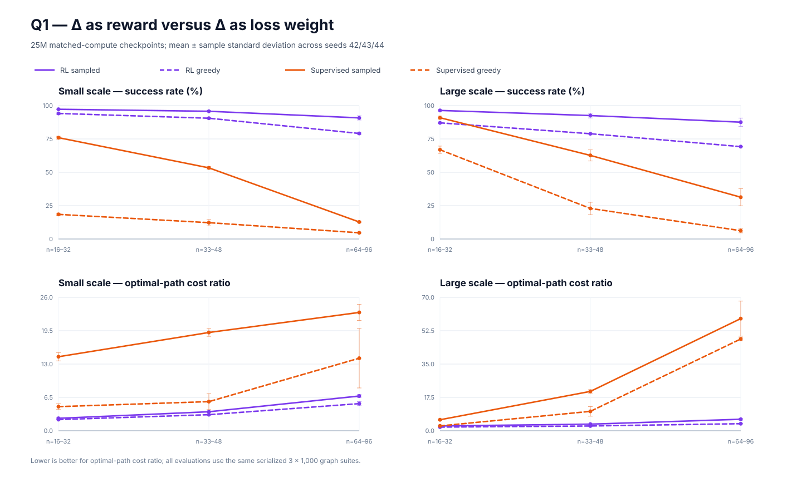
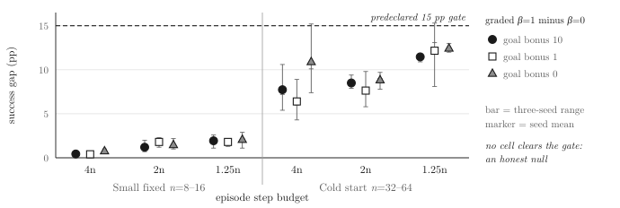
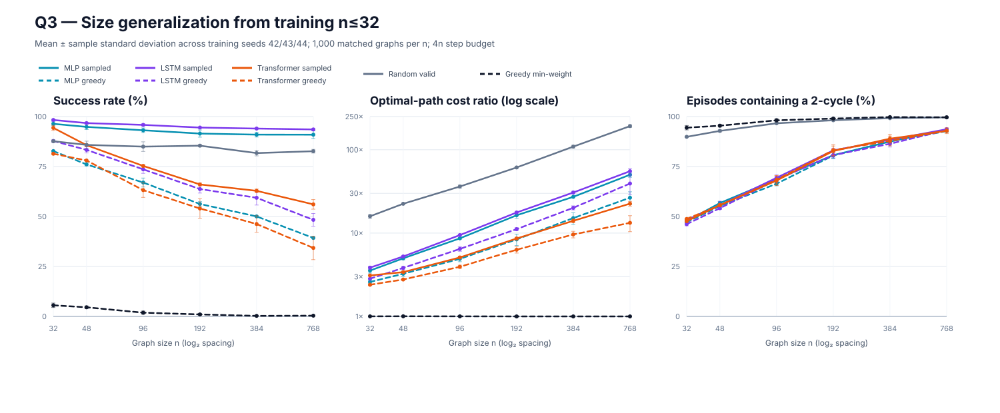

# When does directional reward shaping matter?

## Same regret signal, two learning paradigms, one graph

### Abstract

Potential-based shaping can preserve optimal policies, but that guarantee does
not say when shaping improves finite-budget learning or whether the same
directional signal works better as a reward than as supervised guidance. We
study shortest-path execution on random connected weighted graphs with a local
observation: at each node, an agent sees at most the eight cheapest incident
edges and must reach a hidden target. The exact Dijkstra regret
\(\Delta(u,v)=w(u,v)+\phi(v)-\phi(u)\) is used in two ways: as a per-token
teacher-forcing signal in a supervised sequence model and, with
\(\phi(x)=d(x,\mathrm{target})\), as the reinforcement-learning reward
\(-\Delta/w_{\max}\). All comparisons use three training seeds and frozen
1,000-graph suites.

At the 25M matched-compute point, sampled RL reaches 90.8% far-OOD
success at the small scale and 87.6% at the large scale, versus 12.8% and
31.3% for supervised learning. RL also takes fewer backward steps and produces
far cheaper successful walks. Twenty-four matched cells exceed the
predeclared five-point success threshold, twenty-four exceed the 0.5
optimality-gap threshold, and six size-degradation comparisons have
non-overlapping three-seed ranges. The cross-paradigm gate therefore passes
without condition selection or tuning.

Two secondary results qualify that comparison. First, a predeclared
54-condition phase diagram finds a coherent 8–12 point shaping advantage on
large cold-start graphs with tight horizons, but no cell reaches the 15-point
gate even after removing the goal bonus. Second, sampled MLP and LSTM policies
retain 90.9% and 93.6% success at 24 times the maximum training size, while a
Transformer falls to 56.1%. Sampling often escapes local two-cycles, but does
not remove them. Together, the experiments show that directional information
is useful, but its learning interface, rollout regime, and decoding rule matter
more than the existence of the signal alone.

## 1. Introduction

Dijkstra's algorithm supplies unusually clean supervision for studying learned
graph search. For every candidate move \(u\rightarrow v\), the shortest-path
potential \(\phi\) gives an exact regret:

\[
\Delta(u,v)=w(u,v)+\phi(v)-\phi(u)\geq 0.
\]

An optimal move has zero regret. The same quantity can therefore grade a
teacher-forced target, shape an RL reward, or serve only as an evaluation
diagnostic. This creates a controlled question that is obscured in most
learned-search comparisons: **what changes when the information is held fixed
but the learning paradigm changes?**

We make three contributions.

1. We compare supervised soft-KL training and PPO-based RL on identical,
   hash-pinned graph suites, at two parameter scales and two matched-compute
   budgets. We report greedy and sampled decoding, success, path-cost
   optimality gap, and backward-step rate.
2. We predeclare and execute a reward-shaping phase diagram over graph size,
   rollout horizon, and terminal bonus. Null results are retained: the largest
   graded-versus-sparse gap is 12.4 points, below our 15-point gate.
3. We test size generalization through \(n=768\), 24 times the largest training
   graph, and expose a success-efficiency-decoding tradeoff that is invisible
   in success alone.

The resulting story is deliberately narrower than a claim that RL generally
outperforms supervised learning. It is evidence about local-observation graph
walkers trained from the same exact shortest-path signal under a controlled
compute and evaluation protocol.

## 2. Related work

Potential-based shaping preserves optimal policies under its standard
conditions [1], while later work studies learning or optimizing shaping rewards
[2, 3]. Our question is narrower: when does an exact potential improve a fixed
finite-budget learner?

Neural algorithmic reasoning studies whether learned executors recover and
generalize classical procedures [5–10, 15]. We instead hold the local
shortest-path signal fixed and compare how supervised and RL objectives expose
it to the learner.

Learned graph search also includes differentiable planning [11] and learned
local or combinatorial heuristics [12–14]. Our policies do not replace a global
solver: they execute a partially observed walk and must recover from their own
earlier decisions.

## 3. Task and experimental protocol

### 3.1 Local graph walking

Each episode samples a connected weighted graph, a source, and a target. At the
current node, the policy observes \(K=8\) neighbor slots. Each slot contains a
valid flag, normalized edge weight, visited flag, and target flag; two global
features encode rollout progress and clipped graph size. If a node has degree
greater than eight, the environment exposes the eight cheapest edges with a
deterministic weight/node-id tie break. The policy never receives a global
adjacency matrix or the Dijkstra potential.

Training begins on \(n\in[8,16]\) and, unless an experiment disables the
curriculum, expands to \(n=32\) after rolling success exceeds 0.9. The default
episode horizon is \(4n\). An action mask is derived from the observed valid
flags; every reported experiment has an invalid-action rate of zero.

### 3.2 Rewards and supervised signal

The graded environment reward is

\[
r(u,v)=\frac{-w(u,v)+\beta(\phi(u)-\phi(v))}{w_{\max}}-c,
\]

plus a terminal goal bonus. At \(\beta=1\), the non-step-cost component is
exactly \(-\Delta(u,v)/w_{\max}\). We compare it with \(\beta=0\), called
"sparse" for continuity with the experiment harness, and with a binary penalty
for moves that increase distance to the target. The \(\beta=0\) condition still
pays edge and step cost; with zero terminal bonus it is not literally
reward-free.

The supervised sibling uses its established soft-KL configuration and weights
teacher-forced decisions by the same Dijkstra regret. Small and large models
are matched to the RL LSTM and Transformer at approximately 185k and 532k
parameters. Supervised checkpoints are selected both by matched estimated
training compute and by the full 20,000-step training budget.

### 3.3 Evaluation and decision rules

Every learned model is trained with seeds 42, 43, and 44. Q1 uses three frozen
1,000-graph suites:

- train scale, \(n\in[16,32]\);
- near OOD, \(n\in[33,48]\);
- far OOD, \(n\in[64,96]\).

Both greedy and categorical sampled decoding are evaluated. Success is the
fraction of episodes reaching the target. Optimality gap is path cost divided
by the true source-target shortest-path cost and is defined over successful
episodes. Backward rate is the fraction of valid moves that increase
\(\phi\). We additionally count whether an episode exhibits a two-cycle
\(u\rightarrow v\rightarrow u\).

Before running the experiments, we declared Q1 interesting if either paradigm
won by more than five success points or 0.5 optimality gap in any matched cell,
or if size-degradation slopes differed. Q2 required a 15-point
graded-minus-sparse success gap with non-overlapping seed ranges. Q3 required
one architecture to retain more than 80% success at eight times training size
while another collapsed, or a ranking reversal. These gates are tests of
practical effect size, not post-hoc significance thresholds.

## 4. Results

### 4.1 The learning interface dominates the shared signal

Parameter matching is close: the small comparison is 183,081 RL parameters
versus 185,192 supervised, and the large comparison is 531,202 versus 532,152.
The supervised checkpoints selected for the 5M and 25M matches are within
1.4% of the RL multiply-accumulate estimates.

The 25M sampled comparison summarizes the main result:

| Scale | Suite | RL success | Supervised success | Difference |
|---|---|---:|---:|---:|
| small | train scale | 97.2 ± 0.2% | 76.0 ± 1.0% | +21.3 pp |
| small | near OOD | 95.8 ± 0.6% | 53.3 ± 1.0% | +42.4 pp |
| small | far OOD | 90.8 ± 1.6% | 12.8 ± 0.6% | **+78.0 pp** |
| large | train scale | 96.4 ± 0.4% | 90.9 ± 1.3% | +5.5 pp |
| large | near OOD | 92.5 ± 1.8% | 62.7 ± 4.2% | +29.9 pp |
| large | far OOD | 87.6 ± 3.1% | 31.3 ± 6.5% | **+56.2 pp** |

Greedy decoding does not reverse the result. On the far-OOD suite, the 25M
small RL policy reaches 79.1% success versus 4.7% supervised, while the large
RL policy reaches 69.2% versus 6.3%. The supervised models are not merely
slightly less robust: their sampled train-to-far success drops are 63.2 points
at the small scale and 59.6 points at the large scale, compared with 6.4 and
8.8 points for RL. Those degradation ranges do not overlap across the three
training seeds.

Path behavior points in the same direction. In the 25M far-OOD sampled cells,
RL backward rates are 33.4% at both scales, versus 46.2% supervised. Successful
RL walks have optimality gaps 6.8 and 6.0, versus 23.1 and 58.9 supervised.
The comparison is especially important because optimality gap is conditional
on success: supervised greedy sometimes reports a deceptively low gap when
almost every episode fails.

The predeclared gate passes broadly rather than through one outlier. Twenty-four
matched cells exceed a strict five-point success difference, twenty-four
exceed a strict 0.5 optimality-gap difference, and six train-to-far degradation
comparisons have non-overlapping seed ranges. The largest success difference
is 80.6 points (small, 5M, train-scale, greedy); the largest optimality-gap
difference is 52.8 (large, 25M, far-OOD, sampled).

The decoding rule is part of the result rather than an implementation detail.
Supervised sampling frequently rescues policies that fail under argmax, but the
rescued trajectories can be extremely inefficient. Optimality gap must
therefore be read jointly with success: a low gap in a near-zero-success greedy
cell describes only the rare episodes that terminate.

### 4.2 Shaping helps coherently, but misses its predeclared gate

We trained LSTM policies for five million agent steps across three reward modes,
three rollout horizons, two graph-size regimes, and three seeds. The hardest
cell removes curriculum, begins directly at \(n\in[32,64]\), and allows only
\(1.25n\) steps.

| Start regime | Horizon | Graded success | Sparse success | Difference |
|---|---:|---:|---:|---:|
| \(n=8\)–16 fixed | \(4n\) | 99.7% | 99.3% | +0.4 pp |
| \(n=8\)–16 fixed | \(2n\) | 97.7% | 96.5% | +1.2 pp |
| \(n=8\)–16 fixed | \(1.25n\) | 95.1% | 93.1% | +1.9 pp |
| \(n=32\)–64 cold | \(4n\) | 97.1% | 89.3% | +7.7 pp |
| \(n=32\)–64 cold | \(2n\) | 89.1% | 80.6% | +8.5 pp |
| \(n=32\)–64 cold | \(1.25n\) | 83.2% | 71.7% | **+11.5 pp** |

The trend is consistent: larger cold-start graphs create most of the
separation, and tight horizons strengthen it. Yet the strongest mean
difference is below 15 points. Repeating the complete 54-run grid with goal
bonuses 1 and 0 raises the maximum difference only to 12.2 and 12.4 points.
The Q2 gate is therefore an **honest null**. Directional feedback helps in the
expected regime, but not by the predeclared magnitude. The binary backward
penalty also matches graded shaping in the strongest cell, so the exact
magnitude of Dijkstra regret is not uniquely responsible.

### 4.3 Simple policies retain reachability far out of distribution

Policies trained only through \(n=32\) were evaluated on the same 1,000 graphs
per size through \(n=768\). Sampled success at the largest scales is:

| \(n\) | Random valid | MLP | LSTM | Transformer |
|---:|---:|---:|---:|---:|
| 32 | 87.7% | 96.4% | 98.3% | 94.3% |
| 96 | 85.0% | 93.1% | 95.8% | 75.3% |
| 384 | 81.7% | 91.0% | 94.0% | 62.8% |
| 768 | 82.7% | 90.9% | 93.6% | 56.1% |

Q3 passes its gate at \(n=384\), twelve times the largest training graph, and
the separation widens at \(n=768\). The result is not uniform Transformer
inferiority. On successful \(n=768\) episodes, the Transformer has an
optimality gap of 22.5, less than half the MLP's 50.1 and LSTM's 55.3. It
learns a more efficient but brittle policy, while simpler models preserve
high-probability reachability with increasingly expensive walks.

### 4.4 Sampling escapes local cycles without solving them

At \(n=768\), greedy success is 39.3% for MLP, 48.3% for LSTM, and 34.3% for
Transformer, far below sampled decoding. More than 92% of sampled episodes for
every architecture still contain a two-cycle. Sampling is therefore a
stochastic escape mechanism, not evidence that the learned deterministic
controller avoids the pathology.

Classical controls clarify this behavior. A uniform random valid walk retains
82–88% success under the generous \(4n\) horizon but has catastrophic path
cost and near-universal two-cycles. Greedy minimum-edge selection achieves an
approximately optimal path cost on the rare episodes that succeed, yet its
success falls below 6% because it locks into deterministic cycles. Success,
efficiency, and local cycling are distinct axes.

## 5. Discussion

### The same information is not the same learning problem

The cross-paradigm comparison controls the graph instances, local observation,
regret definition, model scale, and estimated compute. What remains different
is how the signal reaches the model. Teacher forcing grades actions on expert
states, whereas RL trains on the state distribution induced by the policy's
own mistakes and recoveries. The large OOD separation is consistent with
exposure bias, but this experiment does not isolate exposure bias from all
other optimization differences.

### Potential-based invariance does not predict finite-budget utility

The shaping identity is exact at \(\beta=1\), but the standard
policy-invariance theorem [1] does not guarantee faster PPO learning. Moreover, PPO uses
\(\gamma=0.995\), while the environment implements an undiscounted potential
difference. The Q2 null is therefore informative: curricula, edge costs, goal
termination, and a loose horizon can make an exact directional signal largely
redundant even when it preserves the preferred move locally.

### Reachability can hide poor algorithmic execution

The high random-valid baseline and the sampled two-cycle results warn against
using success alone as evidence of learned algorithm execution. The MLP and
LSTM generalize in reachability, not in shortest-path efficiency. A stronger
claim would require either a tighter horizon, explicit memory/visited-state
control, or a metric that prices exploration directly.

## 6. Limitations

The graph generator, degree truncation, and local feature set define a specific
search distribution. Results do not establish a general ranking between RL and
supervised neural algorithmic reasoning. Parameter count and estimated
multiply-accumulate count are matched, but wall-clock, optimizer dynamics, and
the number of distinct graph states are not identical across paradigms.
Optimality gap is conditional on success and can look deceptively favorable
when few episodes terminate. Three training seeds support practical
effect-size comparisons but are too few for fine-grained distributional
claims. Finally, sampling temperature is fixed in the headline comparison;
the broader temperature sweep should be treated as a decoding ablation, not a
newly tuned result.

## 7. Conclusion

Exact Dijkstra regret is useful, but how it is delivered matters. In this local
graph-walking task, RL trained from \(-\Delta/w_{\max}\) is markedly more robust
than soft-KL teacher forcing on larger held-out graphs. Reward shaping itself
produces a consistent but sub-threshold advantage once curricula and horizons
are controlled. Simple recurrent and feed-forward policies preserve sampled
reachability far beyond their training size, while all learned controllers
retain severe local-cycle pathologies. The strongest conclusion is therefore
not that one architecture executes Dijkstra. It is that robust learned search
must be evaluated as a joint property of training interface, state
distribution, decoding rule, and path efficiency.

## References

1. Ng, Harada, and Russell. Policy invariance under reward transformations:
   Theory and application to reward shaping. ICML, 1999.
2. Hu et al. Learning to Utilize Shaping Rewards: A New Approach of Reward
   Shaping. NeurIPS, 2020.
3. Gupta et al. Behavior Alignment via Reward Function Optimization. ICLR,
   2023.
4. Andrychowicz et al. Hindsight Experience Replay. NeurIPS, 2017.
5. Veličković et al. The CLRS Algorithmic Reasoning Benchmark. ICML, 2022.
6. Veličković et al. Neural Execution of Graph Algorithms. ICLR, 2020.
7. Ibarz et al. A Generalist Neural Algorithmic Learner. LoG, 2022.
8. Bevilacqua et al. Neural Algorithmic Reasoning with Causal Regularisation.
   ICML, 2023.
9. Dudzik and Veličković. Graph Neural Networks are Dynamic Programmers.
   NeurIPS, 2022.
10. Schutz et al. Tackling GNARLy Problems: Graph Neural Algorithmic Reasoning
    Reimagined through Reinforcement Learning. arXiv, 2025.
11. Yonetani et al. Path Planning using Neural A* Search. ICML, 2021.
12. Yolcu and Poczos. Learning Local Search Heuristics for Boolean
    Satisfiability. NeurIPS, 2019.
13. Selsam et al. Learning a SAT Solver from Single-Bit Supervision. ICLR,
    2019.
14. Khalil et al. Learning Combinatorial Optimization Algorithms over Graphs.
    NeurIPS, 2017.
15. Bieber et al. Learning to Execute Programs with Instruction Pointer
    Attention Graph Neural Networks. NeurIPS, 2020.

---

# Appendix

## A. Reproducibility and implementation

The seed path controls Python, NumPy, PyTorch, PufferLib, policy
initialization, action sampling, and graph generation. Every artifact filename
contains its training seed. Identical-seed 16,384-step checks produce
tensor-identical checkpoints and identical non-timing curves.

The environment step kernel was vectorized with NumPy gathers while preserving
graph generation and reset order. Two 120-step characterization traces remain
byte-identical before and after the rewrite. The transition kernel improves
18.7 times, the full reset-heavy environment 2.0 times, and a 500k-step
LSTM/PPO workload 1.3 times. Exact random graph generation and Dijkstra during
resets account for most of the remaining environment time.

Q1 RL uses Muon with learning rate 0.015. All remote processes use one
OMP/MKL/OpenBLAS thread, at most two concurrent GPU processes, and reduced
scheduling priority. The remote platform is a GTX 1080 with compute capability
6.1. A CUDA 12.6 PyTorch wheel is used because CUDA 13 removes Pascal support.

## B. Frozen Q1 suites

| Suite | Range | Graphs | SHA-256 |
|---|---:|---:|---|
| train scale | 16–32 | 1,000 | `c848ff46125e1cf6998a505a094a6efeb3e170091a67b7b241623a5a42727463` |
| near OOD | 33–48 | 1,000 | `dba06cb89c76e674abc8d960ace768eca1ac13db2d2111eb724f8a8847b6145c` |
| far OOD | 64–96 | 1,000 | `d93e4b086a054660f3e40d0e8d7b0170abb35569bae29e6d8d7a359207d83bbc` |

The graph-generator hash is
`5a9de1c8ff44c693f797cb09c50d66b2374a810033b1163767c7ce8f7f3cd9f5`.
Hashes are verified before remote evaluation and again after every artifact
transfer.

## C. Complete result artifacts

Machine-readable results and human-readable experiment reports are committed
under `paper-results/`. Raw curves, checkpoints, manifests, and per-condition
evaluation JSONs are retained locally under ignored `viz-data/`. The Q1 report
contains every paradigm, parameter scale, compute budget, graph suite,
decoding mode, and metric aggregate; the Q2 and Q3 reports contain the complete
phase diagram and size-generalization tables rather than only the selected
headline cells.

## D. Q1 integrity and gate audit

The merged Q1 dataset contains exactly 72 RL rows and 108 supervised rows:
two parameter scales, the declared compute/reference budgets, three training
seeds, three suites, and two decoding rules. Every one of the 180 rows has
`invalid_rate = 0.0`. The gate is computed over all matched cells before any
headline cell is selected:

- 24 cells exceed the strict five-point absolute success threshold;
- 24 cells exceed the strict 0.5 absolute optimality-gap threshold;
- 6 degradation comparisons have non-overlapping three-seed ranges.

No crashed scientific run was silently repeated. The only first-attempt
failures occurred before model execution because `/usr/bin/time` was absent;
their tracebacks were retained and each was retried once with shell epoch
timing. All remaining training and evaluation processes completed on their
first attempt.
